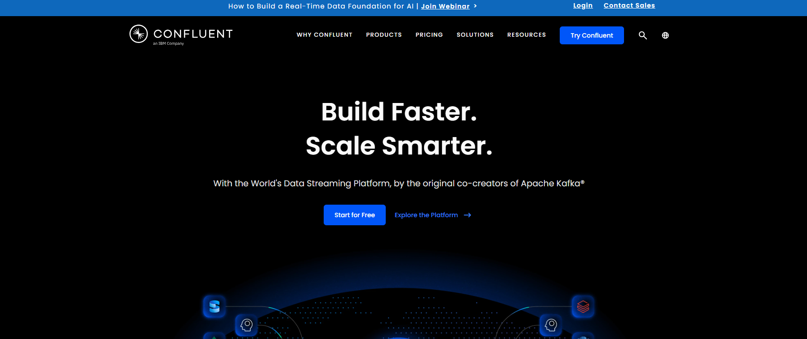

# Week 3, Day 2 — Tasks (6 Hrs)
## Build Your Own Producer, Start to Finish

Nothing is pre-set-up today — you're creating everything yourself, step by step. Follow each step in order and don't skip ahead; each one depends on the last.

You'll need the `superstore_sales_sample.csv` file from Week 1 — locate it on your machine before starting.

---

## Task 1 — Create Your Free Confluent Cloud Account
1. Go to **confluent.io** and click **Sign Up Free**.
2. Create an account with your email (no credit card needed for the free tier).
3. Log in to the console once your account is ready.

**Write down:** what does the console home screen show you once you log in?

---

## Task 2 — Create a Cluster
1. Click **Create Cluster** (or **Add Cluster**).
2. Choose the **Basic** cluster type (free-tier friendly).
3. Pick any cloud provider and region — it doesn't matter which for this course.
4. Give it a name, e.g. `week3-cluster`, and click **Launch Cluster**.
5. Wait for the cluster status to show as active/ready.

---

## Task 3 — Create Your Topic
1. Inside your new cluster, click **Topics** in the left sidebar.
2. Click **Create Topic**.
3. Name it `my_orders`.
4. Leave all other settings at their defaults.
5. Click **Create**.

**Write down:** what settings did you see on the create-topic screen, even ones you left untouched? Just note what's there.

---

## Task 4 — Create an API Key
1. In the left sidebar, click **API Keys**.
2. Click **Create Key**, and choose "scoped to this cluster."
3. Save the **Key** and **Secret** somewhere safe (a text file) — you'll paste these into your script and you won't be able to see the secret again later.

- KVSN226VZUCGXMIE
- cfltd8VtX2TS0PpyY58UcLetDr6KlxFQQMQna9fI1gjwbJ0Lo4vLgBejm2U4w2Gg

---

## Task 5 — Run It and Watch

1. You should see one line printed per row, roughly one per second.
2. While it's running, switch to the Confluent Cloud console → your `my_orders` topic → **Messages** tab.
3. Watch the same rows appear there, live.

**Write down:** did the order of rows in the console match the order they were sent? What was the delay, roughly, between a row printing in your terminal and appearing in the console?

---

## End-of-Day Checklist
- [ ] I created my own Confluent Cloud account and cluster
- [ ] I created my own topic (`my_orders`)
- [ ] I created an API key and saved it safely
- [ ] I watched my own rows arrive live in the Confluent Cloud console
