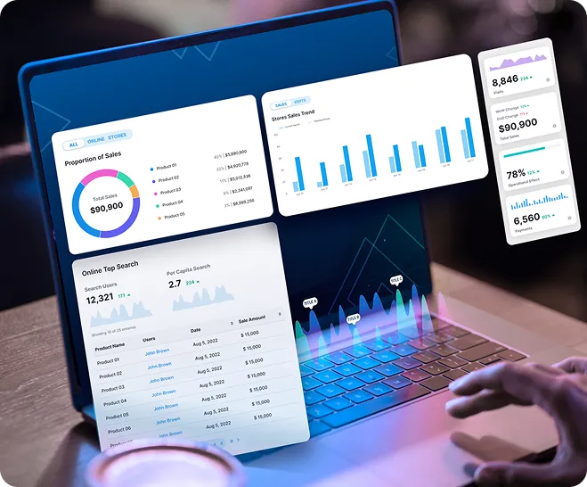

# Week 4 — Power BI: Visualization & Reporting

## Week Goal
Weeks 1–2 taught the student to shape data (batch, at rest). Week 3 taught them to catch data as it moves (streaming). This week closes the loop: once data has been ingested, cleaned, joined, and even streamed, someone still has to *look* at it and make a decision from it. Power BI is where the data engineering work finally becomes visible to a human — a stakeholder, a manager, a client — who will never open a notebook or write a query.

This is a deliberate shift in audience. Weeks 1–3 were written for the student wearing a data engineering hat, talking to systems. Week 4 is the student wearing the same hat, but now talking to *people* — translating pipeline output into something a non-technical decision-maker can trust and act on in five seconds.

**Key line to repeat to student throughout the week:** *"You've spent three weeks getting data ready. This week is the only week where someone other than you actually sees the result."*

## Setup Note: Power BI's Place in the Stack
Power BI is not a data engineering tool in the way Spark or Kafka are — it doesn't transform or move data at scale. But it depends entirely on data engineering having done its job correctly upstream: if the ingestion was sloppy, the joins were wrong, or the schema drifted, Power BI will happily visualize garbage with total confidence. Part of this week's lesson is that **a dashboard is only as trustworthy as the data engineering pipeline feeding it** — Power BI has no way of knowing the data is wrong.

For this week, the student connects Power BI Desktop to the outputs already produced in Weeks 1–2 (the cleaned/joined `superstore_sales_sample` tables) rather than starting from raw data again — reinforcing that visualization sits *after* data engineering, not instead of it.

---

## Dataset Used
Same dataset family as every prior week — **`superstore_sales_sample.csv`**, but now in its cleaned, transformed form from Week 2 (and optionally the aggregated streaming output from Week 3, if the student wants to show a "live-ish" tile). No new domain to learn — only a new destination for data that's already been engineered correctly.

---

## Week Structure

| Day | Focus | Real-World Question It Answers |
|-----|-------|----------------------------------|
| 1 | Power BI basics — connecting to data, the Power BI mental model (Get Data → Model → Report) | "Once data engineering hands off clean data, what does Power BI actually do with it?" |
| 2 | Data modeling in Power BI — relationships, star schema basics | "Why does the join logic I learned in Spark still matter here?" |
| 3 | DAX fundamentals — calculated columns and measures | "How do I turn raw columns into business metrics?" |
| 4 | Visuals & dashboard design — choosing the right chart, layout principles | "How do I make a decision-maker trust this at a glance?" |
| 5 | Mini reporting project — end-to-end dashboard from engineered data, guided | "Can I take a pipeline's output and turn it into something a manager can act on?" |

---

## Teaching Principles (Same as Weeks 1–3, plus one addition)
1. Every new command/feature is introduced through the business problem it solves, not the UI click-path itself
2. Bridge from what the student already knows (Week 2's cleaned tables → "same data, new job: make it readable")
3. Repeat prior day's concepts at the start of every session
4. One core new idea per day
5. **New this week:** explicitly separate the *data engineering* work (already done, upstream) from the *reporting* work (this week) — the student should be able to say which week's skill produced which part of the final dashboard
6. Week ends with a real mini project the student can point to and say "I built this"

---

## Deliverable by End of Week 4
A working Power BI report that:
1. Connects to the cleaned/transformed data engineering output from Week 2
2. Establishes a correct data model (relationships between tables)
3. Includes at least 2–3 DAX measures answering real business questions
4. Presents the result as a clean, decision-ready dashboard with appropriate visuals

This mirrors, in miniature, exactly what happens at the end of a real data engineering pipeline in industry — the same pattern behind executive dashboards and reporting layers built on top of engineered data.

---
*See `Week4_Day1_Concepts.md` / `Week4_Day1_Tasks.md` and `Week4_Day2_Concepts.md` / `Week4_Day2_Tasks.md` for detailed daily breakdowns.*